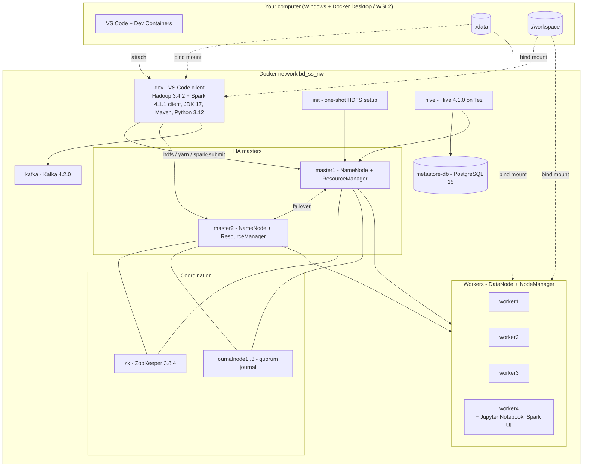

<<<<<<< HEAD
# bdss-dev-cluster
A complete high-availability big data cluster (HDFS · YARN · Spark · Hive · Kafka) with a VS Code development environment, built to run on a single laptop.
=======
# BDSS Dev Cluster

**A complete high-availability big data cluster (HDFS · YARN · Spark · Hive · Kafka) with a VS Code development environment, built to run on a single laptop.**

> **Built by Mohamed** ([@fogknight-10](https://github.com/fogknight-10)) - repository: [fogknight-10/bdss-dev-cluster](https://github.com/fogknight-10/bdss-dev-cluster)
> Built using the original *Big Data, Small Steps* cluster by [usf-etman](https://github.com/usf-etman/bdss-cluster).
> The cluster images and the service configuration come from that project and are used unchanged.

---

## Table of contents

1. [Overview](#1-overview)
2. [What this build adds to the original cluster](#2-what-this-build-adds-to-the-original-cluster)
3. [Architecture](#3-architecture)
4. [Technology versions](#4-technology-versions)
5. [Requirements](#5-requirements)
6. [Quick start](#6-quick-start)
7. [Container reference](#7-container-reference)
8. [Web interfaces and ports](#8-web-interfaces-and-ports)
9. [Folders, bind mounts and volumes](#9-folders-bind-mounts-and-volumes)
10. [Working with files (no more copying into the image)](#10-working-with-files-no-more-copying-into-the-image)
11. [Using the stack](#11-using-the-stack)
12. [Configuration (`.env`)](#12-configuration-env)
13. [Operations](#13-operations)
14. [Verification and assumptions to confirm](#14-verification-and-assumptions-to-confirm)
15. [Troubleshooting](#15-troubleshooting)
16. [Roadmap](#16-roadmap)
17. [Repository layout](#17-repository-layout)
18. [Credits and licensing](#18-credits-and-licensing)

---

## 1. Overview

BDSS Dev Cluster runs a 13-container Hadoop/Spark/Hive/Kafka cluster with **automatic failover** (two NameNodes, two ResourceManagers, a ZooKeeper-coordinated three-node JournalNode quorum and four workers), plus a **VS Code client container** that lives on the same Docker network. You write code in VS Code, in your own project folder, and run it on the cluster without copying files into any container image.

Highlights:

- **Full HA cluster** - HDFS and YARN with active/standby masters and ZooKeeper failover.
- **Spark 4.1.1 on YARN**, Hive 4.1.0 on Tez, Iceberg and DataFusion Comet support from the original images, and a single-node Kafka 4.2.0 broker.
- **VS Code development environment** - attach VS Code (Dev Containers) to a client container that has the *same* Hadoop and Spark binaries and configuration as the cluster, plus JDK 17, Maven and Python 3.12 with the Jupyter extension.
- **Jupyter Notebook** from the original cluster is kept on `worker4` (port 8000).
- **Shared folders** - `./data` and `./workspace` are mapped to the same paths (`/data`, `/workspace`) on the dev container and on every worker.
- **Persistent state** - HDFS blocks, NameNode metadata, journals, ZooKeeper, the Hive metastore and Kafka survive `docker compose down`.
- **Self-check tooling** - `verify-cluster.sh` and `smoke_test.py` prove that HA, HDFS, YARN, shared folders and Kafka work.

> **Built using the original big data cluster.** Source: <https://github.com/usf-etman/bdss-cluster>. Images used: `ysfetman/bdss-hadoop-base:3.4.2`, `ysfetman/bdss-hadoop-spark:4.1.1`, `ysfetman/bdss-hadoop-jupyter:3.12`, `ysfetman/bdss-hadoop-hive:4.1.0`.

---

## 2. What this build adds to the original cluster

| Area | Original cluster | BDSS Dev Cluster |
|---|---|---|
| Development environment | Jupyter Notebook inside `worker4` only | **Dedicated VS Code client container** (Dev Containers) with the cluster's Hadoop/Spark, JDK 17, Maven, Python 3.12; JupyterLab on `worker4` is kept |
| Shared folders | `./volumes/data` and `./volumes/notebooks` only | `./data` and `./workspace` mapped to identical paths on the dev container and all four workers |
| HDFS persistence | NameNode and JournalNode 1 on the host; no DataNode, JournalNode 2/3 or metastore storage | **All state in named volumes**: ZooKeeper, 3 JournalNodes, 2 NameNodes, 4 DataNodes, Hive metastore, Kafka |
| Startup order | `master1` waited only for `journalnode3` | `master1` waits for **all three** JournalNodes; every JournalNode has a health check |
| Format markers | Health checks looked at a file outside the persisted folder | Health checks also accept existing NameNode metadata, so a re-created container does not hang |
| Kafka | No storage, no health check, default transaction settings | Persisted data, health check, single-broker transaction settings |
| Container names and ports | Fixed | Name prefix and **every host port configurable in `.env`** |
| HDFS first-run setup | Manual | `init` container creates the HDFS folders and can mirror `./data` into HDFS |
| Verification | None | `scripts/verify-cluster.sh` and `scripts/smoke_test.py` |
| Line endings | Environment files and some data with Windows (CRLF) endings | Environment files normalised to LF and `.gitattributes` protecting scripts |
| Compose file | `version: '3.8'` (obsolete) | Modern Compose (`name:`, YAML anchors) |

Unchanged on purpose: all images, the Hadoop/Spark/Hive/Zookeeper/Kafka configuration baked into them, the four environment files (content), the startup scripts, the `privileged` flag on two JournalNodes, and the hard-coded `hive/hive` metastore credentials (they must match the Hive image).

---

## 3. Architecture



**How the pieces cooperate**

- ZooKeeper elects which NameNode and which ResourceManager is *active*; the other is *standby*. Either `master1` or `master2` can be the active one at any time, so clients must address HDFS by its **nameservice**, never by a master's host name. The original cluster's own metadata shows the nameservice is called `bdss`.
- The three JournalNodes store the shared edit log. Two of three must be available for a NameNode to commit changes.
- Spark runs on YARN: your driver (in `dev` or `worker4`) asks the active ResourceManager for containers, which start on `worker1..4`. Executors read `file:///data` from their own bind mount or `hdfs:///...` from the DataNodes.
- Hive stores its metadata in PostgreSQL and its tables in HDFS.

---

## 4. Technology versions

As published by the original cluster, plus what the dev container adds.

| Component | Version |
|---|---|
| Java (cluster images) / JDK (dev container) | 17 / OpenJDK 17 (full JDK) |
| Python (cluster Jupyter image, dev container) | 3.12 |
| Apache Hadoop (HDFS, YARN, MapReduce) | 3.4.2 |
| Apache ZooKeeper | 3.8.4 |
| Apache Spark (PySpark taken from `/opt/spark`) | 4.1.1 |
| Apache Hive on Tez | 4.1.0 |
| PostgreSQL (Hive metastore) | 15 |
| Apache Kafka (KRaft, single node) | 4.2.0 |
| Apache Iceberg / DataFusion Comet | 1.10.1 / 0.14.0 (shipped in the Spark image) |
| Apache Maven | Debian 12 package (dev container) |
| Dev container base image | `mcr.microsoft.com/devcontainers/python:1-3.12-bookworm` |

---

## 5. Requirements

| Item | Needed |
|---|---|
| Operating system | Windows 10/11 with WSL2 (Linux should work too; not tested) |
| Docker | Docker Desktop with Compose v2 |
| Editor | Visual Studio Code with the **Dev Containers** extension |
| CPU | 4 cores or more |
| Memory | The original cluster asks for 8 GB minimum and 12 GB or more preferred. This build adds one client container, so **give Docker at least 12 GB** (16 GB machine recommended). This is an estimate, not a measurement - check with `docker stats` |
| Disk | About 10 GB for the original images (original README) plus the dev image; keep 20 GB or more free |
| Network | Needed on the first start to pull images and Python packages |

On Windows, give WSL2 enough memory in `%UserProfile%\.wslconfig`, then run `wsl --shutdown`:

```ini
[wsl2]
memory=12GB
processors=6
```

Keep the project folder **inside the WSL2 filesystem** (for example `\\wsl$\Ubuntu\home\<you>\bdss-dev-cluster`) rather than on `C:\` - bind mounts from Windows drives are noticeably slower.

---

## 6. Quick start

```bash
# 1. Get the project
git clone https://github.com/fogknight-10/bdss-dev-cluster.git
cd bdss-dev-cluster

# 2. Build the dev image and start everything (first run downloads several GB)
docker compose up -d --build

# 3. Watch it come up (masters wait for ZooKeeper and the JournalNodes; this takes a few minutes)
docker compose ps

# 4. The one-shot containers init and dn-perms must show "Exited (0)"
docker compose ps -a init dn-perms
```

Open VS Code:

- **Option A (recommended)** - with the stack already running, use *Dev Containers: Reopen in Container*. VS Code reuses the running services and installs the extensions listed in `.devcontainer/devcontainer.json` (Python, Pylance, **Jupyter**, Java, Maven, YAML, CSV).
- **Option B** - *Dev Containers: Attach to Running Container...* and pick `bdss-dev`. Attaching ignores `devcontainer.json`: you only get the extensions that ship with the base image (Python, Pylance, ESLint, autopep8). Add the others once with *Dev Containers: Open Attached Container Configuration File* and this content, then reopen:

```json
{
  "workspaceFolder": "/workspace",
  "remoteUser": "vscode",
  "extensions": ["ms-python.python", "ms-python.vscode-pylance", "ms-toolsai.jupyter", "redhat.vscode-yaml", "mechatroner.rainbow-csv", "redhat.java", "vscjava.vscode-maven"],
  "settings": { "python.analysis.extraPaths": ["/opt/spark/python", "/opt/spark/python/lib/py4j-src.zip"] }
}
```

**The first connection takes about two minutes**: VS Code copies its 220 MB server into the container and installs the extensions. The server and extensions are stored in the `vscode-server` volume, so this happens again only after `docker compose down -v` or when VS Code itself updates.

Then, in a VS Code terminal inside the container:

```bash
bash /opt/bdss-scripts/verify-cluster.sh      # configuration and health check
python /opt/bdss-scripts/smoke_test.py        # HDFS + Spark on YARN + Kafka end to end
```

and open `workspace/notebooks/00_quickstart.ipynb`.

---

## 7. Container reference

The tables in sections 7 and 8 are generated from `docker-compose.yml`. Container names use the `STACK_NAME` prefix (default `bdss`).

### 7.1 Summary

| # | Service | Container | Image | Role |
|---|---|---|---|---|
| 1 | `zk` | `bdss-zk` | `zookeeper:3.8.4` | ZooKeeper - ZAB consensus; elects the active NameNode / ResourceManager (automatic failover). |
| 2 | `journalnode1` | `bdss-journalnode1` | `ysfetman/bdss-hadoop-base:3.4.2` | HDFS JournalNode 1 - quorum journal that shares the edit log between the two NameNodes. |
| 3 | `journalnode2` | `bdss-journalnode2` | `ysfetman/bdss-hadoop-base:3.4.2` | HDFS JournalNode 2 - quorum journal (2 of 3 must agree). |
| 4 | `journalnode3` | `bdss-journalnode3` | `ysfetman/bdss-hadoop-base:3.4.2` | HDFS JournalNode 3 - quorum journal; the original cluster's readiness gate. |
| 5 | `master1` | `bdss-master1` | `ysfetman/bdss-hadoop-base:3.4.2` | NameNode + ResourceManager (started as the active pair); formats HDFS on the first start. |
| 6 | `master2` | `bdss-master2` | `ysfetman/bdss-hadoop-base:3.4.2` | NameNode + ResourceManager (standby pair); bootstraps from master1. |
| 7 | `dn-perms` | `bdss-dn-perms` | `busybox:1.37` | One-shot job: makes the four DataNode volumes writable for the workers' unprivileged user before any worker starts, then exits. |
| 8 | `worker1` | `bdss-worker1` | `ysfetman/bdss-hadoop-spark:4.1.1` | DataNode + NodeManager - stores HDFS blocks and runs YARN containers (Spark executors). |
| 9 | `worker2` | `bdss-worker2` | `ysfetman/bdss-hadoop-spark:4.1.1` | DataNode + NodeManager - stores HDFS blocks and runs YARN containers (Spark executors). |
| 10 | `worker3` | `bdss-worker3` | `ysfetman/bdss-hadoop-spark:4.1.1` | DataNode + NodeManager - stores HDFS blocks and runs YARN containers (Spark executors). |
| 11 | `worker4` | `bdss-worker4` | `ysfetman/bdss-hadoop-jupyter:3.12` | Worker (DataNode + NodeManager) that also hosts Jupyter Notebook (port 8000) and the Spark UI / history server (port 18080); notebooks are kept in /home/user/notebooks. |
| 12 | `metastore-db` | `bdss-metastore-db` | `postgres:15` | PostgreSQL 15 - metadata database of the Hive Metastore. |
| 13 | `hive` | `bdss-hive` | `ysfetman/bdss-hadoop-hive:4.1.0` | Hive 4.1.0 on Tez (HiveServer2, web UI on 10002); metadata in metastore-db. |
| 14 | `kafka` | `bdss-kafka` | `apache/kafka:4.2.0` | Apache Kafka 4.2.0, single node in KRaft mode (broker + controller). |
| 15 | `dev` | `bdss-dev` | `bdss-dev:latest` | VS Code client: Hadoop 3.4.2 + Spark 4.1.1 client, JDK 17, Maven, Python 3.12, Jupyter kernel. Not part of the cluster. |
| 16 | `init` | `bdss-init` | `bdss-dev:latest` | One-shot job: waits for the active NameNode, creates HDFS folders, optionally mirrors ./data into HDFS, then exits. |

### 7.2 Details of every container

### `bdss-zk`  (service `zk`)

ZooKeeper - ZAB consensus; elects the active NameNode / ResourceManager (automatic failover).

| Property | Value |
|---|---|
| Image | `zookeeper:3.8.4` |
| Hostname (inside Docker) | `zookeeper` |
| Published ports (host -> container) | `2181` -> `2181` |
| Mounts | volume `zk-data` -> `/data`<br>volume `zk-datalog` -> `/datalog` |
| Starts after | - |
| Health check | `echo ruok \| nc localhost 2181 \| grep -q imok` every 10s, 10 retries |

### `bdss-journalnode1`  (service `journalnode1`)

HDFS JournalNode 1 - quorum journal that shares the edit log between the two NameNodes.

| Property | Value |
|---|---|
| Image | `ysfetman/bdss-hadoop-base:3.4.2` |
| Hostname (inside Docker) | `journalnode1` |
| Published ports (host -> container) | `18480` -> `8480` |
| Mounts | volume `jn1` -> `/opt/hadoop/dfs/journal` |
| Starts after | - |
| Health check | `nc -z localhost 8485` every 5s, 30 retries |
| Command | `/scripts/jn.sh` |
| Privileged | yes (kept from the original cluster) |

### `bdss-journalnode2`  (service `journalnode2`)

HDFS JournalNode 2 - quorum journal (2 of 3 must agree).

| Property | Value |
|---|---|
| Image | `ysfetman/bdss-hadoop-base:3.4.2` |
| Hostname (inside Docker) | `journalnode2` |
| Published ports (host -> container) | `28480` -> `8480` |
| Mounts | volume `jn2` -> `/opt/hadoop/dfs/journal` |
| Starts after | - |
| Health check | `nc -z localhost 8485` every 5s, 30 retries |
| Command | `/scripts/jn.sh` |
| Privileged | yes (kept from the original cluster) |

### `bdss-journalnode3`  (service `journalnode3`)

HDFS JournalNode 3 - quorum journal; the original cluster's readiness gate.

| Property | Value |
|---|---|
| Image | `ysfetman/bdss-hadoop-base:3.4.2` |
| Hostname (inside Docker) | `journalnode3` |
| Published ports (host -> container) | `38480` -> `8480` |
| Mounts | volume `jn3` -> `/opt/hadoop/dfs/journal` |
| Starts after | - |
| Health check | `nc -z localhost 8485` every 5s, 30 retries |
| Command | `/scripts/jn.sh` |

### `bdss-master1`  (service `master1`)

NameNode + ResourceManager (started as the active pair); formats HDFS on the first start.

| Property | Value |
|---|---|
| Image | `ysfetman/bdss-hadoop-base:3.4.2` |
| Hostname (inside Docker) | `master1` |
| Published ports (host -> container) | `19870` -> `9870`, `18088` -> `8088` |
| Mounts | volume `nn1` -> `/opt/hadoop/dfs/name` |
| Starts after | `zk` (healthy), `journalnode1` (healthy), `journalnode2` (healthy), `journalnode3` (healthy) |
| Health check | `test -f /opt/hadoop/dfs/.formatted \|\| test -f /opt/hadoop/dfs/name/current/VERSION` every 5s, 60 retries |
| Command | `/scripts/active_nn.sh` |

### `bdss-master2`  (service `master2`)

NameNode + ResourceManager (standby pair); bootstraps from master1.

| Property | Value |
|---|---|
| Image | `ysfetman/bdss-hadoop-base:3.4.2` |
| Hostname (inside Docker) | `master2` |
| Published ports (host -> container) | `29870` -> `9870`, `28088` -> `8088` |
| Mounts | volume `nn2` -> `/opt/hadoop/dfs/name` |
| Starts after | `master1` (healthy) |
| Health check | `test -f /opt/hadoop/dfs/.bootstrapped \|\| test -f /opt/hadoop/dfs/name/current/VERSION` every 5s, 60 retries |
| Command | `/scripts/standby_nn.sh` |

### `bdss-dn-perms`  (service `dn-perms`)

One-shot job: makes the four DataNode volumes writable for the workers' unprivileged user before any worker starts, then exits.

| Property | Value |
|---|---|
| Image | `busybox:1.37` |
| Hostname (inside Docker) | `-` |
| Published ports (host -> container) | none |
| Mounts | volume `dn1` -> `/v/dn1`<br>volume `dn2` -> `/v/dn2`<br>volume `dn3` -> `/v/dn3`<br>volume `dn4` -> `/v/dn4` |
| Starts after | - |
| Health check | none |
| Command | `sh -c chmod 777 /v/dn1 /v/dn2 /v/dn3 /v/dn4` |

### `bdss-worker1`  (service `worker1`)

DataNode + NodeManager - stores HDFS blocks and runs YARN containers (Spark executors).

| Property | Value |
|---|---|
| Image | `ysfetman/bdss-hadoop-spark:4.1.1` |
| Hostname (inside Docker) | `worker1` |
| Published ports (host -> container) | none |
| Mounts | `./data` -> `/data`<br>`./workspace` -> `/workspace`<br>volume `dn1` -> `/tmp/hadoop-user` |
| Starts after | `master2` (healthy), `dn-perms` (completed_successfully) |
| Health check | none |
| Command | `/scripts/worker.sh` |

### `bdss-worker2`  (service `worker2`)

DataNode + NodeManager - stores HDFS blocks and runs YARN containers (Spark executors).

| Property | Value |
|---|---|
| Image | `ysfetman/bdss-hadoop-spark:4.1.1` |
| Hostname (inside Docker) | `worker2` |
| Published ports (host -> container) | none |
| Mounts | `./data` -> `/data`<br>`./workspace` -> `/workspace`<br>volume `dn2` -> `/tmp/hadoop-user` |
| Starts after | `master2` (healthy), `dn-perms` (completed_successfully) |
| Health check | none |
| Command | `/scripts/worker.sh` |

### `bdss-worker3`  (service `worker3`)

DataNode + NodeManager - stores HDFS blocks and runs YARN containers (Spark executors).

| Property | Value |
|---|---|
| Image | `ysfetman/bdss-hadoop-spark:4.1.1` |
| Hostname (inside Docker) | `worker3` |
| Published ports (host -> container) | none |
| Mounts | `./data` -> `/data`<br>`./workspace` -> `/workspace`<br>volume `dn3` -> `/tmp/hadoop-user` |
| Starts after | `master2` (healthy), `dn-perms` (completed_successfully) |
| Health check | none |
| Command | `/scripts/worker.sh` |

### `bdss-worker4`  (service `worker4`)

Worker (DataNode + NodeManager) that also hosts Jupyter Notebook (port 8000) and the Spark UI / history server (port 18080); notebooks are kept in /home/user/notebooks.

| Property | Value |
|---|---|
| Image | `ysfetman/bdss-hadoop-jupyter:3.12` |
| Hostname (inside Docker) | `worker4` |
| Published ports (host -> container) | `18080` -> `18080`, `8000` -> `8000`, `4040` -> `4040` |
| Mounts | `./workspace/notebooks` -> `/home/user/notebooks`<br>`./data` -> `/data`<br>`./workspace` -> `/workspace`<br>volume `dn4` -> `/tmp/hadoop-user` |
| Starts after | `master2` (healthy), `dn-perms` (completed_successfully) |
| Health check | `pgrep -f 'DataNode' > /dev/null` every 10s, 6 retries |
| Command | `/scripts/worker.sh` |

### `bdss-metastore-db`  (service `metastore-db`)

PostgreSQL 15 - metadata database of the Hive Metastore.

| Property | Value |
|---|---|
| Image | `postgres:15` |
| Hostname (inside Docker) | `metastore-db` |
| Published ports (host -> container) | `6432` -> `5432` |
| Mounts | volume `metastore-data` -> `/var/lib/postgresql/data` |
| Starts after | - |
| Health check | `pg_isready -U hive -d metastore -h localhost` every 5s, 20 retries |

### `bdss-hive`  (service `hive`)

Hive 4.1.0 on Tez (HiveServer2, web UI on 10002); metadata in metastore-db.

| Property | Value |
|---|---|
| Image | `ysfetman/bdss-hadoop-hive:4.1.0` |
| Hostname (inside Docker) | `hive` |
| Published ports (host -> container) | `10002` -> `10002` |
| Mounts | none |
| Starts after | `worker4` (healthy), `metastore-db` (healthy) |
| Health check | none |
| Command | `/scripts/hive.sh` |

### `bdss-kafka`  (service `kafka`)

Apache Kafka 4.2.0, single node in KRaft mode (broker + controller).

| Property | Value |
|---|---|
| Image | `apache/kafka:4.2.0` |
| Hostname (inside Docker) | `kafka` |
| Published ports (host -> container) | `9092` -> `9092` |
| Mounts | volume `kafka-data` -> `/var/lib/kafka/data` |
| Starts after | - |
| Health check | `/opt/kafka/bin/kafka-broker-api-versions.sh --bootstrap-server localhost:9092 > /dev/null 2>&1` every 10s, 12 retries |

### `bdss-dev`  (service `dev`)

VS Code client: Hadoop 3.4.2 + Spark 4.1.1 client, JDK 17, Maven, Python 3.12, Jupyter kernel. Not part of the cluster.

| Property | Value |
|---|---|
| Image | `bdss-dev:latest` |
| Hostname (inside Docker) | `dev` |
| Published ports (host -> container) | `8888` -> `8888`, `4050` -> `4040` |
| Mounts | `./workspace` -> `/workspace`<br>`./data` -> `/data`<br>`./scripts` -> `/opt/bdss-scripts` (read-only)<br>volume `vscode-server` -> `/home/vscode/.vscode-server` |
| Starts after | `worker4` (healthy), `kafka` (healthy), `hive` (started) |
| Health check | none |
| Command | `sleep infinity` |

### `bdss-init`  (service `init`)

One-shot job: waits for the active NameNode, creates HDFS folders, optionally mirrors ./data into HDFS, then exits.

| Property | Value |
|---|---|
| Image | `bdss-dev:latest` |
| Hostname (inside Docker) | `init` |
| Published ports (host -> container) | none |
| Mounts | `./data` -> `/data`<br>`./scripts` -> `/opt/bdss-scripts` (read-only) |
| Starts after | `worker4` (healthy) |
| Health check | none |
| Command | `bash /opt/bdss-scripts/hdfs-init.sh` |


---

## 8. Web interfaces and ports

Host ports are the defaults from `.env`; change them there.

| Component | Host address | Container | Service |
|---|---|---|---|
| ZooKeeper client port | localhost:2181 | `zk:2181` | `zk` |
| JournalNode 1 UI | http://localhost:18480 | `journalnode1:8480` | `journalnode1` |
| JournalNode 2 UI | http://localhost:28480 | `journalnode2:8480` | `journalnode2` |
| JournalNode 3 UI | http://localhost:38480 | `journalnode3:8480` | `journalnode3` |
| HDFS NameNode UI (master1) | http://localhost:19870 | `master1:9870` | `master1` |
| YARN ResourceManager UI (master1) | http://localhost:18088 | `master1:8088` | `master1` |
| HDFS NameNode UI (master2) | http://localhost:29870 | `master2:9870` | `master2` |
| YARN ResourceManager UI (master2) | http://localhost:28088 | `master2:8088` | `master2` |
| Spark UI / history server (worker4) | http://localhost:18080 | `worker4:18080` | `worker4` |
| Jupyter Notebook (worker4, original cluster) | http://localhost:8000 | `worker4:8000` | `worker4` |
| Spark application UI (worker4 driver, while a job runs) | http://localhost:4040 | `worker4:4040` | `worker4` |
| PostgreSQL (Hive metastore) - user/db `hive`/`metastore` | localhost:6432 | `metastore-db:5432` | `metastore-db` |
| HiveServer2 UI | http://localhost:10002 | `hive:10002` | `hive` |
| Kafka broker (advertised as `kafka:9092`: containers only) | localhost:9092 | `kafka:9092` | `kafka` |
| JupyterLab (dev container, optional - start it manually) | http://localhost:8888 | `dev:8888` | `dev` |
| Spark application UI (dev container driver, while a job runs) | http://localhost:4050 | `dev:4040` | `dev` |

Which NameNode is active? Open both NameNode UIs - the header shows *active* or *standby*. The same applies to the two ResourceManagers.

---

## 9. Folders, bind mounts and volumes

### 9.1 Your folders (bind mounts - visible on the host and in the containers)

| Host folder | Container path | Mounted in |
|---|---|---|
| `./data` | `/data` | `worker1`, `worker2`, `worker3`, `worker4`, `dev`, `init` |
| `./workspace` | `/workspace` | `worker1`, `worker2`, `worker3`, `worker4`, `dev` |
| `./workspace/notebooks` | `/home/user/notebooks` | `worker4` |
| `./scripts` | `/opt/bdss-scripts` | `dev`, `init` |

| Host folder | What to put there |
|---|---|
| `data/` | Your datasets. The folder content is **not published** with the repository (third-party terms; see `data/README.md`); the quick-start notebook and the smoke test create their own sample files here |
| `workspace/notebooks/` | Notebooks. Also mounted into `worker4` at `/home/user/notebooks` |
| `workspace/jobs/` | `spark-submit` scripts |
| `scripts/` | Helper scripts, mounted read-only into `dev` and `init` at `/opt/bdss-scripts` |

### 9.2 Cluster state (named volumes)

| Named volume | Mounted in | Container path | Holds |
|---|---|---|---|
| `zk-data` | `zk` | `/data` | ZooKeeper snapshots |
| `zk-datalog` | `zk` | `/datalog` | ZooKeeper transaction log |
| `jn1` | `journalnode1` | `/opt/hadoop/dfs/journal` | JournalNode 1 edit log |
| `jn2` | `journalnode2` | `/opt/hadoop/dfs/journal` | JournalNode 2 edit log |
| `jn3` | `journalnode3` | `/opt/hadoop/dfs/journal` | JournalNode 3 edit log |
| `nn1` | `master1` | `/opt/hadoop/dfs/name` | NameNode metadata (master1) |
| `nn2` | `master2` | `/opt/hadoop/dfs/name` | NameNode metadata (master2) |
| `dn1` | `dn-perms` | `/v/dn1` | HDFS blocks (worker1) |
| `dn1` | `worker1` | `/tmp/hadoop-user` | HDFS blocks (worker1) |
| `dn2` | `dn-perms` | `/v/dn2` | HDFS blocks (worker2) |
| `dn2` | `worker2` | `/tmp/hadoop-user` | HDFS blocks (worker2) |
| `dn3` | `dn-perms` | `/v/dn3` | HDFS blocks (worker3) |
| `dn3` | `worker3` | `/tmp/hadoop-user` | HDFS blocks (worker3) |
| `dn4` | `dn-perms` | `/v/dn4` | HDFS blocks (worker4) |
| `dn4` | `worker4` | `/tmp/hadoop-user` | HDFS blocks (worker4) |
| `metastore-data` | `metastore-db` | `/var/lib/postgresql/data` | Hive metastore database |
| `kafka-data` | `kafka` | `/var/lib/kafka/data` | Kafka topics and offsets |
| `vscode-server` | `dev` | `/home/vscode/.vscode-server` | VS Code Server and installed extensions (saves a ~2 minute download after re-creating the container) |

DataNode blocks are stored in `hadoop.tmp.dir` of the workers' user, `/tmp/hadoop-user`, so the `dn1`-`dn4` volumes are mounted there. Because Docker creates a new volume owned by root, the one-shot `dn-perms` container makes the volumes writable before the workers start.

Why named volumes instead of host folders? DataNodes and PostgreSQL insist on Linux file permissions that Windows-drive bind mounts cannot provide, and keeping all cluster state in the same kind of storage means it always has a consistent life cycle.

| Command | Effect on state |
|---|---|
| `docker compose stop` / `start` | State kept |
| `docker compose down` | Containers removed, **state kept** |
| `docker compose down -v` | **Everything deleted** - HDFS contents, metadata, Hive tables, Kafka topics, and the cached VS Code Server. Your `data/` and `workspace/` folders are never touched |

Never delete only some of the volumes: HDFS metadata and blocks must stay together. To reset, use `docker compose down -v` and start again.

---

## 10. Working with files (no more copying into the image)

In the original cluster, files seemed to be usable by Spark only after being copied into the Linux container. Two things cause this:

1. Only `volumes/data` and `volumes/notebooks` were mounted, so a file kept anywhere else on your computer is invisible to the containers.
2. In a cluster whose default filesystem is HDFS, a plain path such as `/data/x.csv` is looked up **inside HDFS**, not on the mounted folder. The cluster's metadata shows an HDFS nameservice named `bdss`; confirm the default with `hdfs getconf -confKey fs.defaultFS` (the verification script prints it).

This build gives you three places, all reachable without touching a container image:

| Where | Path in Spark | Visible to | Use it for |
|---|---|---|---|
| `./data` (bind mount) | `file:///data/...` | dev, worker1-4 (same path everywhere) | Raw files you drop in from Windows |
| HDFS | `hdfs:///...` (a bare `/...` also means HDFS if it is the default filesystem) | the whole cluster, persistent | Larger inputs, outputs, Hive tables |
| `./workspace` (bind mount) | `/workspace/...` | dev, worker1-4 | Code, notebooks, helper modules |

```python
# 1) A file you just saved into ./data - readable immediately, no copy:
df = spark.read.csv("file:///data/orders.csv")

# 2) The same data inside HDFS (copy once, then everyone reads it from the cluster):
#       bash /opt/bdss-scripts/hdfs-sync.sh /data /data
df = spark.read.csv("hdfs:///data/orders.csv")

# 3) Results belong in HDFS:
df.write.mode("overwrite").parquet("hdfs:///user/<you>/orders")
```

Set `HDFS_SYNC_ON_START=true` in `.env` to have the `init` container mirror `./data` into `hdfs:///data` at every start.

Rules of thumb: a bind mount is **not** HDFS (nothing replicates it, the host serves it), so write results to HDFS; always use `file:///` or `hdfs:///` explicitly; if you want a folder visible on the workers other than `data` and `workspace`, add the same mount line to all workers in `docker-compose.yml`.

---

## 11. Using the stack

### VS Code (recommended)

Attach to `bdss-dev`. Python, Pylance, Jupyter, Java and Maven extensions install automatically. The container already has `hdfs`, `yarn`, `spark-submit`, `pyspark`, `mvn` and `java` on the PATH with the cluster's configuration.

```bash
hdfs dfs -ls /                                   # talks to the active NameNode
yarn node -list                                  # four RUNNING NodeManagers
pyspark --master yarn                            # interactive PySpark on the cluster
spark-submit --master yarn /workspace/jobs/wordcount.py
```

Notebooks: open a `.ipynb` file in VS Code and pick the *Python 3.12* kernel. `SparkSession.builder.master("yarn")` uses the real cluster; use `local[*]` for quick tests.

The client's Spark driver is reachable by the executors as host name `dev` (`SPARK_LOCAL_HOSTNAME=dev`), which is what lets YARN executors connect back to a driver that runs outside the cluster.

### Jupyter

`http://localhost:8000` is the Jupyter Notebook of the original cluster (inside `worker4`). The folder `workspace/notebooks` on your computer is mounted at `/home/user/notebooks` in that container, where the original cluster keeps its notebooks. The dev container also includes JupyterLab; start it with `jupyter lab --ip 0.0.0.0 --port 8888 --no-browser` and open `http://localhost:8888`.

### MapReduce / Maven

The dev container has the full JDK and Maven, so the original `data/MR/mr_max_temperature` project can be rebuilt with `mvn package`. Its `pom.xml` targets Java 1.8 and older Hadoop libraries; it compiles with JDK 17 but you may want to align it to Hadoop 3.4.2.

### Kafka

Inside the Docker network the broker is `kafka:9092` (`KAFKA_BOOTSTRAP_SERVERS` is preset in the dev container):

```python
from confluent_kafka import Producer
p = Producer({"bootstrap.servers": "kafka:9092"})
p.produce("demo", b"hello"); p.flush()
```

For Spark Structured Streaming use the connector that matches the cluster: `--packages org.apache.spark:spark-sql-kafka-0-10_2.13:4.1.1`.

---

## 12. Configuration (`.env`)

Copy `.env.example` to `.env`; every value has a default.

| Variable | Default | Meaning |
|---|---|---|
| `STACK_NAME` | `bdss` | Prefix of every container name (`bdss-master1`, `bdss-dev`, ...). Change it to run a second copy. |
| `AUTHOR_NAME` | `Mohamed` | Name shown in the dev-container banner and in the image labels. |
| `HADOOP_USER_NAME` | `user` | HDFS identity of the dev and init containers. Must be the owner of `/user` in HDFS: in this cluster that is `user` (`root` is denied). |
| `HADOOP_TMP_DIR` | `/tmp/hadoop-user` | `hadoop.tmp.dir` of the workers' user. The cluster does not set `dfs.datanode.data.dir`, so DataNodes store blocks in `<this>/dfs/data`; this folder is mounted from the `dn1`-`dn4` volumes. |
| `HDFS_SYNC_ON_START` | `false` | `true` = the init container mirrors `./data` into `hdfs:///data` at every start. |
| `NN1_UI_PORT` | `19870` | Host port |
| `NN2_UI_PORT` | `29870` | Host port |
| `RM1_UI_PORT` | `18088` | Host port |
| `RM2_UI_PORT` | `28088` | Host port |
| `JN1_PORT` | `18480` | Host port |
| `JN2_PORT` | `28480` | Host port |
| `JN3_PORT` | `38480` | Host port |
| `HIVE_UI_PORT` | `10002` | Host port |
| `SPARK_HISTORY_PORT` | `18080` | Host port |
| `JUPYTER_PORT` | `8000` | Host port |
| `SPARK_APP_UI_PORT` | `4040` | Host port |
| `ZK_PORT` | `2181` | Host port |
| `METASTORE_DB_PORT` | `6432` | Host port |
| `KAFKA_PORT` | `9092` | Host port |
| `DEV_JUPYTER_PORT` | `8888` | Host port |
| `DEV_SPARK_UI_PORT` | `4050` | Host port |

---

## 13. Operations

```bash
docker compose up -d --build        # start (build the dev image if needed)
docker compose ps                   # status and health
docker compose logs -f master1      # follow one container
docker compose stop                 # stop, keep all state
docker compose start                # start again
docker compose down                 # remove containers, keep state
docker compose down -v              # full reset - deletes all cluster state
docker compose build dev            # rebuild the VS Code client after editing the Dockerfile
docker stats                        # CPU and memory per container
```

Start order is enforced by health checks: `zk` and the three JournalNodes, then `master1`, `master2`, the workers, then `hive`, `kafka`, `dev` and `init` (`dn-perms` runs just before the workers). A cold start takes a few minutes.

Optional failover test: stop the active NameNode container (`docker compose stop master1`), watch the other NameNode UI turn *active*, run `hdfs dfs -ls /`, then `docker compose start master1` - it comes back as standby.

---

## 14. Verification and assumptions to confirm

Run inside the dev container:

| Command | What it checks |
|---|---|
| `bash /opt/bdss-scripts/verify-cluster.sh` | Default filesystem, DataNode directory, HDFS identity (can it write `/user`?), exactly one active and one standby NameNode, 4 live DataNodes, HDFS write/read, 4 running NodeManagers, shared folders, service ports, Java/Spark versions |
| `python /opt/bdss-scripts/smoke_test.py` | HDFS round trip, Spark local and on YARN reading `file:///data`, Python code on executors, Parquet write/read in HDFS, Kafka metadata |

Some settings live **inside the original images** and could not be inspected when this project was assembled. The project is written to work with them, and the verification script tells you if one does not hold:

| Assumption | If it is wrong |
|---|---|
| DataNodes store blocks in `/tmp/hadoop-user/dfs/data` (confirmed on worker1: the image does not set `dfs.datanode.data.dir`, so Hadoop's default under `hadoop.tmp.dir` applies and the workers run as `user`, uid 1002) | The verify script asks each DataNode where it stores blocks; set `HADOOP_TMP_DIR` in `.env` to the folder it reports |
| The HDFS user is `user`, and it can run `dfsadmin` (confirmed by a run: `/user` is owned by `user:supergroup`, mode 755, and `root` was refused) | Set `HADOOP_USER_NAME` in `.env` to the owner of `/user`; `verify-cluster.sh` names it for you |
| `/usr/bin/python3` on the YARN workers is Python 3.12, and the workers have Spark's Python files in `/opt/spark/python` (executors need both for Python code) | The smoke test fails at "Python code runs on YARN executors" with an explanation; adjust `PYSPARK_PYTHON` or the `spark.executorEnv.PYTHONPATH` line the Dockerfile adds to the client's `spark-defaults.conf` |
| The images keep Hadoop in `/opt/hadoop` and Spark in `/opt/spark` | The dev image build fails with a clear message in the `RUN test ...` step |

---

## 15. Troubleshooting

| Symptom | Likely cause and fix |
|---|---|
| `master1` stays *starting* | ZooKeeper or a JournalNode is not healthy yet: `docker compose ps`, `docker compose logs journalnode1` |
| `AccessControlException: Permission denied: user=root, access=WRITE, inode="/user"` | The container is sending HDFS requests as the wrong user. Set `HADOOP_USER_NAME=user` in `.env`, then `docker compose up -d` (no rebuild needed) and restart the notebook kernel |
| `Path does not exist` for a file you can see under `/data` | The path was resolved inside HDFS. Use `file:///data/...` or copy the file to HDFS (section 10) |
| Spark job hangs at *ACCEPTED* | Not enough memory for YARN containers: give Docker more RAM or lower `spark.executor.memory` / `--num-executors` |
| `No module named 'pyspark'` from `/usr/bin/python3` on an executor | The client's `spark-defaults.conf` lacks `spark.executorEnv.PYTHONPATH` (YARN containers do not inherit the NodeManager environment). It is added by the dev image: `docker compose build dev`, then `docker compose up -d` |
| Executors cannot connect to the driver | Run the driver in `dev` (host name `dev`) or `worker4`, not on your Windows host |
| `Log directory ... does not exist` | Create the Spark event-log folder named in the error: `hdfs dfs -mkdir -p <path>` |
| Datanodes missing after `down -v` + `up` | Wait a minute for registration (`hdfs dfsadmin -report`). If one stays missing, read its log: `docker compose logs worker<N>` |
| NameNode stays in safe mode after re-creating workers | HDFS metadata and blocks must be reset together: `docker compose down -v`, then `docker compose up -d` |
| Port already in use | Change the port in `.env`, then `docker compose up -d` |
| `bash\r: No such file or directory` | A script was saved with Windows line endings. Convert to LF (`.gitattributes` prevents this in Git) |
| The first VS Code connection is slow (about 2 minutes) | It installs VS Code Server and the extensions into the new container; the `vscode-server` volume makes later connections fast. Wait for the extension install to finish before running notebooks |
| Jupyter, Java or YAML extensions are missing after *Attach to Running Container* | Attaching ignores `devcontainer.json`. Use *Reopen in Container*, or add the attached-container configuration from section 6 |
| VS Code cannot find the interpreter | *Python: Select Interpreter* -> `/usr/local/bin/python` |
| Slow file access | Move the project into the WSL2 filesystem (section 5) |
| Docker out of space | `docker system df`, then `docker image prune` |

---

## 16. Roadmap

- **Apache Airflow and its own PostgreSQL database** - postponed for a later version. The design is ready: an Airflow container on this network that submits Spark jobs to YARN with the same client binaries as `dev`.
- Memory limits per container once real usage has been measured with `docker stats` (the JVM heap sizes are set inside the original images, so limits were not guessed).

---

## 17. Repository layout

```text
bdss-dev-cluster/
|-- docker-compose.yml          # the whole stack
|-- .env / .env.example         # ports, names, HDFS user, DataNode path
|-- .devcontainer/
|   |-- Dockerfile              # VS Code client (Hadoop + Spark copied from the cluster image)
|   |-- devcontainer.json       # VS Code: service, extensions, settings
|   `-- requirements.txt        # Python packages
|-- env_files/                  # hadoop.env, spark.env, hive.env, zk.env (from the original cluster)
|-- scripts/
|   |-- verify-cluster.sh       # health and configuration check
|   |-- smoke_test.py           # end-to-end test
|   |-- hdfs-init.sh            # run by the init container
|   `-- hdfs-sync.sh            # copy a folder into HDFS
|-- data/                       # bind-mounted at /data; content is git-ignored (see data/README.md)
|-- workspace/                  # bind-mounted at /workspace
|   |-- notebooks/00_quickstart.ipynb
|   `-- jobs/wordcount.py
|-- .gitattributes  .gitignore  .dockerignore
`-- README.md
```

---

## 18. Credits, licensing and support

### Repository and author

- **Repository:** <https://github.com/fogknight-10/bdss-dev-cluster>
- **Author:** Mohamed - GitHub [@fogknight-10](https://github.com/fogknight-10)
- **Questions and bugs:** open an issue at <https://github.com/fogknight-10/bdss-dev-cluster/issues>. Please attach the output of `bash /opt/bdss-scripts/verify-cluster.sh` and `docker compose ps -a`.

### Built using the original big data cluster

- **Original cluster:** *Big Data, Small Steps* by **usf-etman** - <https://github.com/usf-etman/bdss-cluster>. The Docker images (`ysfetman/bdss-hadoop-*`), the cluster configuration and scripts inside them, and the four environment files in `env_files/` originate there. This project builds on them and adds the VS Code client, shared folders, persistence, health checks, scripts and documentation described in section 2. The original repository publishes no license file, so these parts are reused with attribution; if you are the original author and want them changed or removed, please open an issue.
- Apache Hadoop, Spark, Hive, Tez, ZooKeeper, Kafka and Iceberg are Apache Software Foundation projects; PostgreSQL has its own license; VS Code and Dev Containers are Microsoft products.

### Datasets

No datasets are published in this repository. The sample datasets of the original cluster have their own terms; for example the MovieLens 100k README states that the data may not be redistributed without separate permission. Obtain them from the original repository (see `data/README.md`) and keep them on your own computer.

### License

No license has been selected yet for the files written for this repository (compose file, Dockerfile, scripts, notebooks, documentation). Until a `LICENSE` file is added, the default copyright rules apply.

```text
=====================================================================
  BDSS Dev Cluster
  Built by Mohamed (github.com/fogknight-10) - October 2026
  Repository: https://github.com/fogknight-10/bdss-dev-cluster
  Built using the original Big Data, Small Steps cluster by usf-etman
  https://github.com/usf-etman/bdss-cluster
=====================================================================
```
>>>>>>> da9d6b5 (Initial commit: BDSS Dev Cluster)
